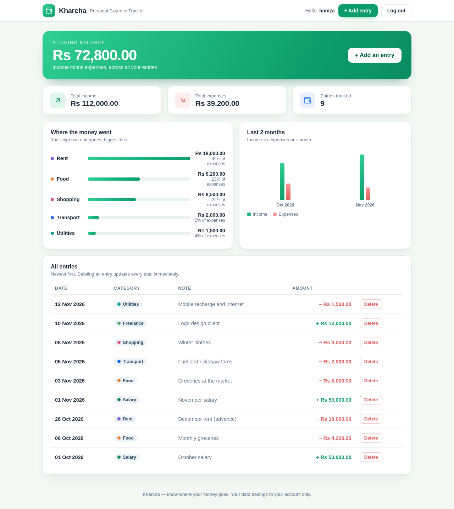
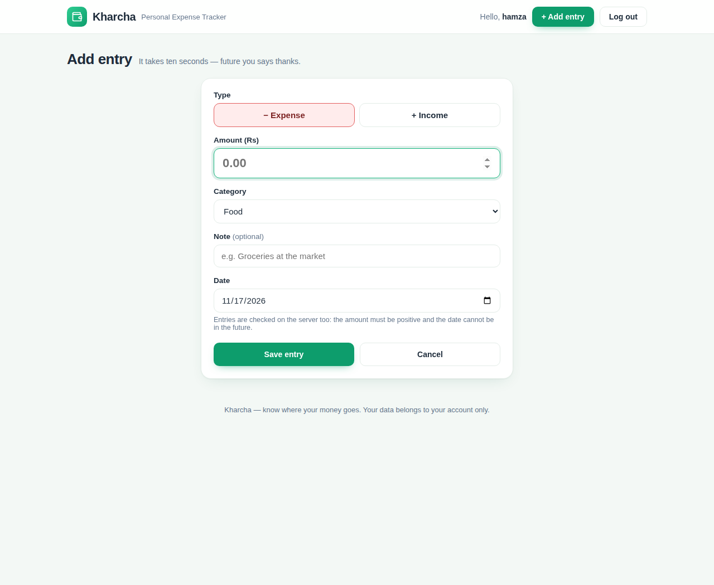
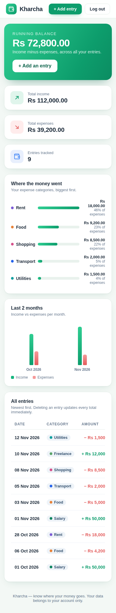

# Kharcha — Personal Expense Tracker

**Kharcha** (Urdu: خرچہ, "expense") is a private, single-purpose web app that answers one everyday question: *where did my money go this month?*

Record income and expenses in seconds, and Kharcha keeps your running balance, per-category totals and a month-by-month summary up to date — no spreadsheets, no guesswork.

**🌐 Live demo: [kharcha-40qt.onrender.com](https://kharcha-40qt.onrender.com)** — create a free account and try it in the browser. (Hosted on a free tier, so the first load after a quiet spell can take up to a minute.)



## Features

- **Accounts & privacy** — register / log in / log out with salted-hash passwords (Werkzeug) and Flask sessions. Every query is scoped to the signed-in user: nobody can see, edit or delete another user's entries.
- **Fast entry** — income/expense toggle, amount, category, optional note and date. The server re-validates everything (positive amounts, real dates, no future dates), so bad data never reaches the database.
- **Dashboard that explains itself**
  - Gradient balance hero with the running balance
  - Total income / total expenses / entries tracked stat cards
  - *Where the money went* — expense categories ranked with share bars
  - *Last 6 months* — income vs expenses chart, rendered server-side (no JavaScript chart library)
  - Full entry history with category pills, human-readable dates and one-click delete
- **Thoughtful empty state** — new accounts get a guided first step instead of a blank page.
- **Responsive, hand-rolled design system** — custom CSS design tokens (no CSS framework), Inter typeface, sticky glass top bar, dismissible flash messages, mobile layout that keeps amounts visible.

## Screenshots

| Add entry | Mobile dashboard |
| --- | --- |
|  |  |

## Tech stack

| Layer | Choice | Why |
| --- | --- | --- |
| Language | Python 3 | Clear, explicit code |
| Framework | Flask 3 | Small surface, easy to reason about |
| Database | SQLite (stdlib `sqlite3`) | Zero setup; schema auto-creates on first run |
| Templates | Jinja2 | Presentation helpers live in Python filters, templates stay dumb |
| Styling | Custom CSS | One design-token file; no framework weight |
| Server | Gunicorn | Production WSGI for deployment |

## Project structure

```
kharcha/
├── app.py                  # routes, validation, DB access, template filters
├── requirements.txt        # Flask + gunicorn
├── templates/
│   ├── layout.html         # top bar, flash messages, footer
│   ├── index.html          # dashboard (hero, stats, charts, entries)
│   ├── add.html            # add-entry form
│   ├── login.html
│   └── register.html
├── static/
│   ├── styles.css          # the design system
│   └── favicon.svg
└── docs/                   # screenshots
```

## Run it locally

```bash
git clone https://github.com/hamza-474/kharcha.git
cd kharcha
python3 -m venv .venv && source .venv/bin/activate
pip install -r requirements.txt
flask --app app run          # or: python app.py
```

Open http://127.0.0.1:5000, create an account, and add your first entry. The SQLite database (`kharcha.db`) is created automatically — nothing else to set up. Set a real `SECRET_KEY` environment variable outside local development.

## Data model

Two tables, created by `init_db()` at startup:

- **users** — `id`, unique `username`, password `hash`
- **entries** — `id`, `user_id` (FK, cascade delete), `kind` (`income` | `expense`, CHECK-constrained), `amount` (> 0), `category`, `note`, `date`, `created_at`; indexed on `(user_id, date)`

## Origin

Kharcha began as the final project for Harvard's **CS50x: Introduction to Computer Science** (2026) and was then reworked to a production-style standard: a hand-built design system, charted dashboard, deployment configuration and this documentation. Demo video: https://youtu.be/-TVhZ_8_5Zs

## License

MIT — free to use, learn from, and build on.
